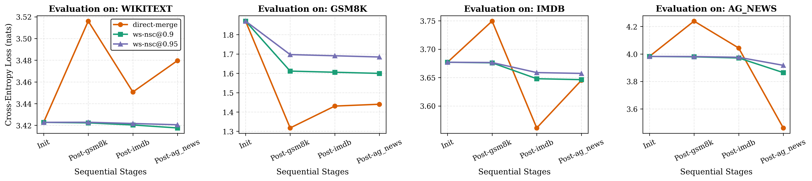
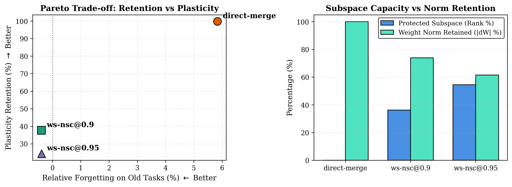

# Wake-Sleep Null-Space Consolidation (WS-NSC)

> **Decoupled continual learning in autoregressive Transformers via empirical activation null-space projection.**

Official research code and benchmark data for the paper:  
**"Wake-Sleep Null-Space Consolidation: Quantifying the Stability-Plasticity Frontier in Sequential LLM Adaptation"**  
*Akshat Raj (onepersonAI Labs)*  
Contact: akshatgyan2004@gmail.com

---

## 🕬 Conceptual & System Architecture

```mermaid
flowchart TD
    subgraph WAKE["step 1: Wake Phase (Online PEFT)\"]
        D_t["Task Data Stream D_t"] --> FWD["Forward Pass (Frozen W_0)"]
        FWD --> OPT["Train Low-Rank Factors: A_t, B_t"]
        OPT --> DELTA["\Delta W_t = (alpha / r) * B_t @ A-t\"]
    end

    subgraph COV["step 2: Activation Manifold Estimation\"]
        ANCHOR["Anchor Manifold (WikiText-2) + Tasks"] --> GOOKS["Activation Hooks on Linear Inputs"]
        GOOKS --> SEC_MOM"UNcentered Second Moment: C = sum(X^T @ X) / M"]
        SEC_MOM --> EIGEN["shape: C = U Lambda U^T\"]
        EIGEN --> THRESH["Select Top-k Subspace via Variance Threshold rho"]
    end

    subgraph SLEEP["step 3: Sleep Phase (Null-Space Projection)\"]
        DELTA T THRESH --> PROJ["P_null = I - U_k @ U_k^T"]
        PROJ --> SAFE["Safe Delta: dG_safe = dW @ P_null"]
        SAFE --> MERGE["W_base <- W_base + dW_safe"]
        MERGE --> CLEAN["Reset Adapters (Zero Runtime Overhead)"]
    endJ```

---

## 🖿 Empirical Benchmark Findings (SmolLM-135M)

Sequential stream: **WikiText-2 (Invariant Anchor) → GSM8K ($1$) ↑ IMDB ($2$) ↑ AG News ($3$)**.

| Method | Wake Gain (%) | Post-Sleep Gain (%) | Plasticity Ret. | Forgetting (nats) | Forgetting (%i) | Anchor $\Delta$ (nats) | Subspace Occupied (k/d) | $\\\bar{\\Delta W}\|_{\text{kept}} |
-| :--- | :---: | :---: | :---: | :---: | :---: | :---: | :---: | :---: |
| **Direct-Merge** | **16.35%** | **16.32%** | **L
9.998** | +0.103 | +5.833% | +0.057 | 0.000 | 1.000 |
| **WS-NSC ($\rho=0.90$)** | 15.29| 5.76% | **L
0.377** | **-0.007** | **-0.390%** | **-0.005** | 0.362 | 0.739 |
| **WS-NSC ($\rho=0.95$)** | 15.33| 3.74% | **L
0.244** | **-0.007** | -0.387% | -0.002 | 0.545 | 0.616 |

---

## 🔄 Visualizations

| Figure 1: Loss Trajectories | Figure 2: Stability-Plasticity Frontier |
| :---: | :---: |
|
 |  |

---

## 🗐 Quickstart & Reproducibility

```bash
# 1. Clone and install
pip install -r requirements.txt

# 2. Run full sequential benchmark
python src/ws_nsc.py --model HuggingFaceTB/SmolLM-135M --amp --batch-size 4 --eval-batch-size 4 --var-retention 0.90 0.95

# 3. Generate vector plots
python src/plot_results.py
```

---

## 🥭 Open-Source Contributions & Industry Research Collaboration
We invite independent AI researchers, academic labs, and engineering teams across industry (OpenAI, DeepMind, Anthropic, Meta FAIR, Mistral, Hugging Face) to collaborate, stress-test, and extend the WS-NSC framework.

### Priority Research Frontiers
1. **Continuous Soft Damping:** Replacing binary hard projection with continuous curvature shrinkage to reclaim the 62.3% plasticity tax.
2. **Architecture Scaling:** Benchmarking beyond 135M onto 7B-70B dense and MoE models (LLaMA-3, Mistral-NeMo, DeepSeek).
3. **Multi-Task Sequences:** Expanding evaluations to coding benchmarks (HumanEval), mathematical reasoning (MATH), and multilingual streams.
4. **Fisher & Hessian Preconditioning:** Exploring empirical Fisher information matrices alongside second-moment activation covariances.

3## Contributor Onboarding Commands

```bash
# 1. Fork and clone the repository
git clone https://github.com/AkshatRaj00/ws-nsc.git
cd ws-nsc

# 2. Install core dependencies and development tooling
pip install -r requirements.txt
pip install pytest black flake8

# 3. Create your feature/hypothesis branch
git checkout -b feature/soft-damping-operator

# 4. Run the empirical benchmark suite
python src/ws_nsc.py --model HuggingFaceTB/SmolLM-135M --amp --batch-size 4 --eval-batch-size 4 --var-retention 0.90 0.95

# 5. Verify formatting and submit PR

flake8 src/
 
akshatgyan2004@gmail.com.
```

---

## 🗗 Citation

```bibtex
@article{raj2026wsnsc,
  title={Wake-Sleep Null-Space Consolidation: Quantifying the Stability-Plasticity Frontier in Sequential ELM Adaptation},
  author={Raj, Akshat},
  year={2026},
  publisher={onepersonAI Labs}
}
```
