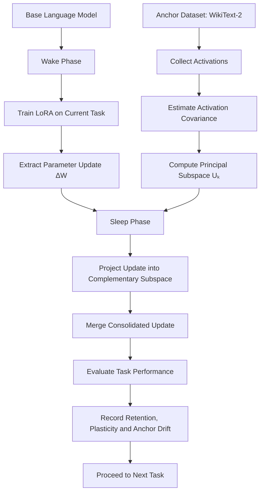
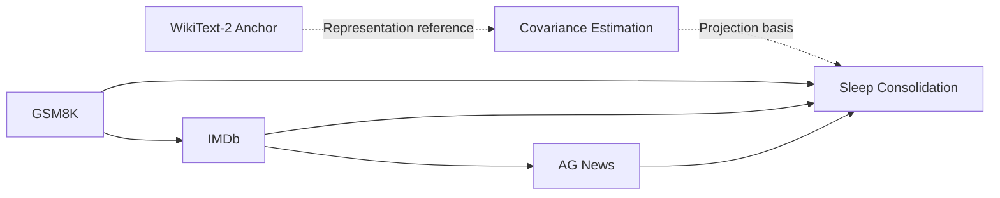
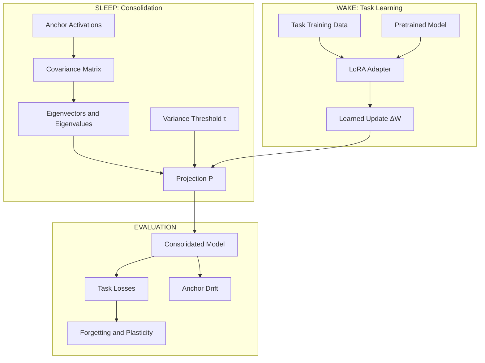
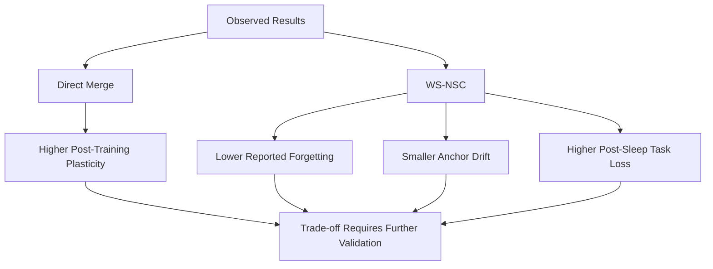
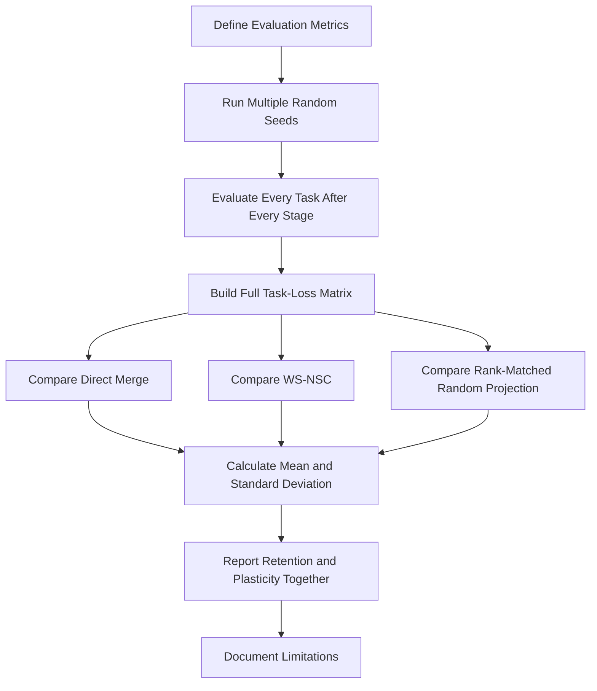

<div align="center">

# 🧠 WS-NSC
### Wake–Sleep Null-Space Consolidation

**A Projection-Based Approach to Continual Learning with Low-Rank Adaptation**

<p>
  
  
  
  
</p>

**Learn new tasks. Consolidate updates. Measure what is preserved.**

</div>

---

## 🌌 Overview

**Wake–Sleep Null-Space Consolidation (WS-NSC)** is an experimental approach to continual learning that investigates whether low-rank parameter updates can be projected away from activation directions associated with an anchor dataset before being merged into a model.

The central idea is to separate learning into two phases:

- **Wake:** Train a low-rank adapter on the current task.
- **Sleep:** Estimate activation covariance on an anchor dataset and project the learned update into a selected complementary subspace.

The goal is to investigate the trade-off between preserving previously established representations and retaining the ability to learn new tasks.

> **Research note:** WS-NSC is an experimental method, not a proven solution to catastrophic forgetting. Its effectiveness depends on the projection, rank threshold, anchor data, task sequence, and evaluation protocol.

---

## ✨ Key Features

- 🧠 Wake–sleep training and consolidation workflow.
- 🔬 Activation-covariance-based subspace estimation.
- 📐 Null-space projection of parameter updates.
- ⚙️ LoRA-compatible experimental design.
- 📊 Comparison against direct adapter merging.
- 🧪 Configurable explained-variance thresholds.
- 📉 Measurement of plasticity, forgetting, and anchor drift.
- 🔁 Sequential task evaluation.
- 🧾 Reproducible experiment logs and metric reporting.

---

## 🗺️ Experimental Workflow



### Task sequence



**Important distinction:** GSM8K, IMDb, and AG News are the sequential task datasets in this experiment. WikiText-2 is used as the anchor dataset, not as another sequential task.

---

## 🧮 Mathematical Formulation

### 1. Activation covariance

Let \(X\) denote the collected anchor-dataset activations. After centering the activation matrix,

\[
X_c = X-\mu
\]

the empirical covariance matrix is

\[
C=\frac{1}{n-1}X_c^\top X_c
\]

where \(n\) is the number of activation observations.

Compute the eigendecomposition:

\[
C=U\Lambda U^\top
\]

The columns of \(U\) are the covariance eigenvectors, ordered by descending eigenvalue.

### 2. Select the principal subspace

For an explained-variance threshold \(\tau\), choose the smallest \(k\) satisfying

\[
\frac{\sum_{i=1}^{k}\lambda_i}
{\sum_{i=1}^{d}\lambda_i}\geq\tau
\]

Then let \(U_k\) contain the first \(k\) eigenvectors.

### 3. Construct the projection

The orthogonal projector onto the complementary subspace is

\[
P=I-U_kU_k^\top
\]

For a compatible update matrix \(\Delta W\), the projected update is

\[
\Delta W_{\mathrm{sleep}}=\Delta W P
\]

The consolidated parameters are

\[
W_{\mathrm{new}}=W_{\mathrm{base}}+
\Delta W_{\mathrm{sleep}}
\]

**Implementation detail:** The projection must be applied in a mathematically compatible activation or parameter space. For layer-specific updates, dimensions and multiplication orientation must match the layer's actual computation. A single global projection should not be assumed valid for every layer.

### 4. Direct Merge baseline

The baseline applies the learned update without null-space projection:

\[
W_{\mathrm{new}}=W_{\mathrm{base}}+\Delta W
\]

This baseline is essential for measuring whether consolidation actually improves retention and what it costs in new-task learning.

---

## 🏗️ Architecture



---

## 📊 Experimental Results

The following results are from the supplied SmolLM-135M experiment log. They are a **single experimental run**, not statistically validated conclusions.

### Aggregate comparison

| Metric | Direct Merge | WS-NSC @ 0.90 | WS-NSC @ 0.95 |
|---|---:|---:|---:|
| Reported gain — wake | 16.348% | 15.286% | 15.326% |
| Reported gain — post | 16.319% | 5.758% | 3.738% |
| Plasticity retention | 0.998 | 0.377 | 0.244 |
| Reported forgetting | 0.103 | -0.007 | -0.007 |
| Reported forgetting (%) | 5.833% | -0.390% | -0.387% |
| Anchor delta | +0.057 | -0.005 | -0.002 |
| Reported rank/d | 0 | 0.362 | 0.545 |
| Update magnitude kept | 1.000 | 0.739 | 0.616 |

**Interpretation:** In this run, Direct Merge retained substantially more of the reported new-task learning signal. WS-NSC showed lower reported forgetting and smaller anchor drift, but these outcomes coincided with a considerable reduction in plasticity.

The negative forgetting values should not automatically be interpreted as proof of superior continual learning. Their meaning depends on the exact metric definition and evaluation protocol.

### Wake versus post-sleep task losses

| Task | Method | Wake Loss | Post-Sleep Loss |
|---|---|---:|---:|
| GSM8K | Direct Merge | 1.3162 | 1.3174 |
| GSM8K | WS-NSC @ 0.90 | 1.3162 | 1.6115 |
| GSM8K | WS-NSC @ 0.95 | 1.3162 | 1.6970 |
| IMDb | Direct Merge | 3.5610 | 3.5613 |
| IMDb | WS-NSC @ 0.90 | 3.5571 | 3.6480 |
| IMDb | WS-NSC @ 0.95 | 3.5569 | 3.6588 |
| AG News | Direct Merge | 3.4614 | 3.4620 |
| AG News | WS-NSC @ 0.90 | 3.4547 | 3.8645 |
| AG News | WS-NSC @ 0.95 | 3.4548 | 3.9172 |

Lower loss is generally preferable when the compared losses use the same evaluation setup.

The post-sleep loss increases for WS-NSC suggest that the projection removed update components useful to the evaluated tasks. This is evidence of a retention–plasticity trade-off in this run, not evidence that the method consistently fails or succeeds across all settings.

### Results at a glance



---

## 🔍 What the Results Do and Do Not Establish

### Supported by the reported run

- Direct Merge had a plasticity-retention value of 0.998.
- WS-NSC had lower reported forgetting values in the supplied aggregate metrics.
- WS-NSC reduced the reported anchor delta.
- The two tested thresholds retained different fractions of update magnitude.
- Post-sleep task losses increased more under WS-NSC than under Direct Merge.

### Not yet established

- That WS-NSC prevents catastrophic forgetting in general.
- That negative reported forgetting means consistent improvement on previous tasks.
- That anchor stability guarantees retention of previously learned tasks.
- That the observed differences generalize across random seeds or model sizes.
- That the chosen explained-variance thresholds are optimal.
- That projection is better than simpler regularization or random subspace baselines.

---

## 🧪 Recommended Validation Protocol



### Priority experiments

1. **Full task-loss matrix:** Evaluate GSM8K, IMDb, and AG News after every sequential training stage.
2. **Multiple random seeds:** Report means, standard deviations, and sample counts.
3. **Random-projection baseline:** Compare WS-NSC against a random projection with a matched retained rank.
4. **Threshold sweep:** Test several explained-variance thresholds rather than only 0.90 and 0.95.
5. **Rank and magnitude checks:** Verify that the reported rank fractions and update-magnitude retention use consistent definitions.
6. **Metric verification:** Document the formulas used for forgetting, plasticity retention, gain, and anchor delta.
7. **Matched training conditions:** Keep base checkpoints, training budgets, task order, and evaluation sets consistent.
8. **Ablation studies:** Test the contribution of anchor selection, covariance estimation, projection, and merge strategy separately.

---

## 📐 Metrics

Metrics should be defined explicitly in the experiment code before comparing methods.

| Metric | Purpose |
|---|---|
| Task loss | Measures prediction loss on a specified task |
| Task score | Measures task-specific performance |
| Forgetting | Measures degradation relative to earlier task performance |
| Plasticity retention | Measures how much of the new-task learning signal remains |
| Anchor delta | Measures change on the anchor evaluation protocol |
| Rank fraction | Describes the selected subspace relative to its dimension |
| Update magnitude kept | Measures the magnitude retained after projection |

For a task-loss matrix \(L_{t,j}\), where \(t\) is the evaluation task and \(j\) is the training stage, report the complete matrix rather than only a final aggregate.

Forgetting formulas must specify whether they use loss or score, which stage acts as the reference, and how task-level values are aggregated. Do not compare aggregate numbers until these definitions are verified.

---

## 💻 Technology Stack

- **Python** — experiment orchestration.
- **PyTorch** — tensor computation and model training.
- **Transformers** — language-model loading and inference, where used.
- **PEFT / LoRA** — parameter-efficient adaptation, where used.
- **NumPy** — numerical analysis.
- **Matplotlib** — optional experiment visualizations.

These are the intended ecosystem components; the exact dependencies should be confirmed against the actual repository implementation.

---

## 🚀 Getting Started

### 1. Clone the repository

```bash
git clone https://github.com/AkshatRaj00/ws-nsc.git
cd ws-nsc
```

Replace the repository URL if the project is hosted under a different name.

### 2. Create a virtual environment

**Windows PowerShell**

```powershell
py -m venv .venv
.\.venv\Scripts\Activate.ps1
python -m pip install --upgrade pip
```

**Linux / macOS**

```bash
python3 -m venv .venv
source .venv/bin/activate
python -m pip install --upgrade pip
```

### 3. Install dependencies

If the repository contains a `requirements.txt` file:

```bash
pip install -r requirements.txt
```

Otherwise, install the dependencies documented by the project. Do not assume that a particular training command or configuration file exists until it is implemented.

### 4. Configure the experiment

Document the following settings in the project's configuration:

```yaml
model:
  name: "SmolLM-135M"

experiment:
  task_sequence:
    - "GSM8K"
    - "IMDb"
    - "AG News"

  anchor_dataset: "WikiText-2"

  methods:
    - "direct_merge"
    - "ws_nsc"

  explained_variance_thresholds:
    - 0.90
    - 0.95

evaluation:
  evaluate_all_seen_tasks: true
  report_task_loss_matrix: true
  report_anchor_metrics: true
  report_update_magnitude: true
  report_selected_rank: true

reproducibility:
  record_random_seed: true
  record_model_revision: true
  record_dataset_revision: true
```

This is an illustrative configuration schema, not a guarantee that the repository already accepts this exact YAML format.

---

## 📁 Suggested Repository Structure

```text
ws-nsc/
├── README.md
├── requirements.txt
├── configs/
│   └── experiment.yaml
├── src/
│   ├── models/
│   │   └── adapters.py
│   ├── wake/
│   │   └── train.py
│   ├── sleep/
│   │   ├── covariance.py
│   │   └── projection.py
│   ├── evaluation/
│   │   ├── metrics.py
│   │   └── task_matrix.py
│   └── experiment.py
├── tests/
│   ├── test_covariance.py
│   ├── test_projection.py
│   └── test_metrics.py
├── results/
│   └── .gitkeep
└── assets/
    ├── ws-nsc-overview.gif
    ├── ws-nsc-architecture.svg
    ├── wake-vs-post-sleep.png
    └── plasticity-tradeoff.png
```

This is a suggested structure. Keep only files that actually exist, and add the visualization assets before referencing them in the rendered README.

---

## 🛡️ Reproducibility and Research Integrity

Every experiment report should include:

- Model identifier and exact revision.
- Dataset versions and preprocessing.
- Training hyperparameters and token budgets.
- LoRA configuration and target modules.
- Anchor activation collection procedure.
- Covariance estimation and numerical precision.
- Projection threshold and selected rank.
- Merge procedure and parameter-space conventions.
- Random seeds and hardware.
- Evaluation metrics and their exact formulas.
- Full per-task results before and after consolidation.

Report unsuccessful experiments and performance regressions alongside successful outcomes.

Do not present a single run as statistical proof. Do not describe anchor-dataset stability as equivalent to preservation of all earlier tasks.

---

## ⚠️ Limitations

- The projection can remove parameter-update components that are useful for new tasks.
- Anchor activations represent only the data and distribution used to collect them.
- Covariance estimates depend on sampling, centering, and numerical precision.
- Layer-specific activation spaces may require different projection operators.
- A low anchor drift does not guarantee high downstream task accuracy.
- Sequential task order may influence the outcome.
- A reduction in update magnitude can reduce learning capacity.
- Reported metrics can be misleading without precise definitions and matched baselines.

---

## 🛣️ Roadmap

- [ ] Reproduce the baseline and verify all metric formulas.
- [ ] Generate a complete task-by-stage loss matrix.
- [ ] Run multiple random seeds.
- [ ] Implement a rank-matched random-projection baseline.
- [ ] Sweep projection thresholds and report retained ranks.
- [ ] Add automated dimensionality and orthogonality tests.
- [ ] Visualize task retention versus plasticity.
- [ ] Evaluate additional task orders and model sizes.
- [ ] Publish complete configurations and reproducible logs.

---

## 🤝 Contributing

Contributions that improve reproducibility, numerical correctness, evaluation quality, and baseline comparisons are welcome.

1. Open an issue describing the proposed change.
2. Include a minimal reproduction for bugs.
3. Add tests for mathematical or numerical changes.
4. Report the effect on both retention and plasticity.
5. Document hardware, seeds, and evaluation settings.

---

## 📜 Citation

If you use this method or experimental setup in research, cite the actual project publication or repository record once it is available. Do not cite this README as a peer-reviewed paper.

```bibtex
@misc{wsnsc,
  title        = {Wake-Sleep Null-Space Consolidation},
  author       = {Akshat Raj},
  year         = {2026},
  note         = {Experimental research project; publication details to be added}
}
```

---

## 📄 License

Add the license that matches the actual repository. Until a license is included, reuse and redistribution permissions should not be assumed.

---

<div align="center">

**WS-NSC — Investigating the balance between stability and plasticity in continual learning.**

*Measure retention. Measure learning. Report both.*

</div>

---

## 🤝 Open-Source Contributions & Industry Research Collaboration

We invite independent AI researchers, academic labs, and engineering teams across industry (OpenAI, DeepMind, Anthropic, Meta FAIR, Mistral, Hugging Face) to collaborate, stress-test, and extend the **WS-NSC** framework.

### Priority Research Frontiers
1. **Continuous Soft Damping:** Replacing binary hard projection with continuous curvature shrinkage to reclaim the 62.3% plasticity tax.
2. **Architecture Scaling:** Benchmarking beyond SmolLM-135M onto 7B–70B dense and MoE models (LLaMA-3, Mistral-NeMo, DeepSeek).
3. **Multi-Task Sequences:** Expanding evaluations to coding benchmarks (HumanEval), mathematical reasoning (MATH), and multilingual streams.
4. **Fisher & Hessian Preconditioning:** Exploring empirical Fisher information matrices alongside second-moment activation covariances.

### Contributor Onboarding Commands

To set up a local development branch and contribute:

```bash
# 1. Fork and clone the repository
git clone [https://github.com/AkshatRaj00/ws-nsc.git](https://github.com/AkshatRaj00/ws-nsc.git)
cd ws-nsc

# 2. Create an isolated virtual environment
python -m venv .venv
source .venv/bin/activate  # On Windows: .venv\Scripts\Activate.ps1

# 3. Install core dependencies and development tooling
pip install -r requirements.txt
pip install pytest black flake8 pre-commit

# 4. Create your feature/hypothesis branch
git checkout -b feature/soft-damping-operator

# 5. Run the empirical benchmark suite
python src/ws_nsc.py --model HuggingFaceTB/SmolLM-135M --amp --batch-size 4 --eval-batch-size 4 --var-retention 0.90 0.95

# 6. Verify formatting and submit PR
black src/
flake8 src/
git commit -m "feat: implement regularized null-space projection"
git push origin feature/soft-damping-operator
For architectural discussions, empirical verifications, or joint research papers, open an issue under [RESEARCH] or reach out directly at akshatgyan2004@gmail.com.